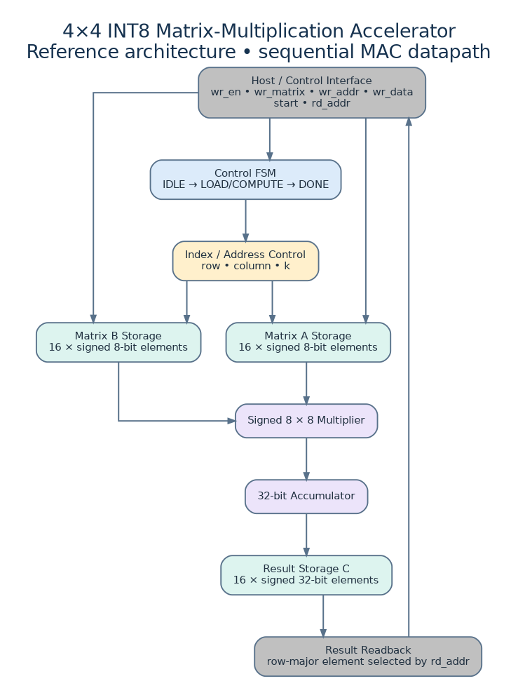

# 4×4 INT8 Matrix-Multiplication Accelerator

## Architecture diagram

## Specification
Computes `C = A × B` for two signed 4×4 matrices. Inputs are signed 8-bit elements; each output is a signed 32-bit accumulator. The host writes A and B one element per cycle through `wr_en`, `wr_matrix`, `wr_addr`, and `wr_data`. `start` begins a calculation; `busy` is high while computing; `done` pulses for one cycle after the final result. `rd_addr` selects a row-major result element.

## Architecture
- Storage: 16 signed elements each for A and B, and 16 signed 32-bit results.
- Compute: one signed multiplier and one accumulator reused across all output elements.
- Loop order: row → column → reduction index k.
- Work: 4×4×4 = 64 multiply-accumulate operations, plus FSM/write overhead.
- Throughput/latency tradeoff: small resource footprint, low result throughput compared with a parallel or systolic architecture.

## Numerical range
A signed INT8 product is in [-16256, 16384]. Four products summed can range approximately [-65024, 65536], comfortably within signed 32-bit output. Wider accumulators are retained for headroom and future dimension changes.

## Important implementation note
This reference RTL is intended for learning and review. Before claiming synthesis-ready production quality, run lint and synthesis for the target tool. Parameter checks should constrain `ACC_W >= 2*DATA_W`; reset/initialization policy for matrix memories should be documented for the chosen FPGA. This design assumes host writes are blocked while `busy` is asserted. The result memory is not cleared on reset; `done` indicates when a newly computed matrix is valid.

## Verification plan
1. Reset then write identity matrix A and a known B; expect C=B.
2. Multiply by zero matrix; all results zero.
3. Multiply identity by identity; output identity.
4. Signed edge values: -128, -1, 0, 127.
5. Start pulse while busy; confirm ignored.
6. Attempt writes while busy; confirm ignored.
7. Check `done` is exactly one cycle and `busy` deasserts.
8. Compare all 16 outputs against a Python integer golden model.

## Improvements
- Parameterized N×N storage and loop counters.
- Parallel MAC lanes or systolic array.
- AXI4-Lite control plus AXI-Stream or DMA data movement.
- Double-buffered A/B memories and interrupt/status registers.
- Saturation or quantization stage for INT8 inference.
- Add a performance counter and synthesis comparison against a parallel implementation.

**HDL:** Synthesizable RTL and smoke testbench are written in Verilog-2001 (`.v`).

## Architecture diagram

Scalable version: [`architecture/01_matrix_accelerator.svg`](architecture/01_matrix_accelerator.svg) · Editable Graphviz source: [`architecture/01_matrix_accelerator.dot`](architecture/01_matrix_accelerator.dot)

Project-specific requirements and recoverable prompt record: [`PROJECT_PROMPTS_AND_REQUIREMENTS.md`](PROJECT_PROMPTS_AND_REQUIREMENTS.md)
